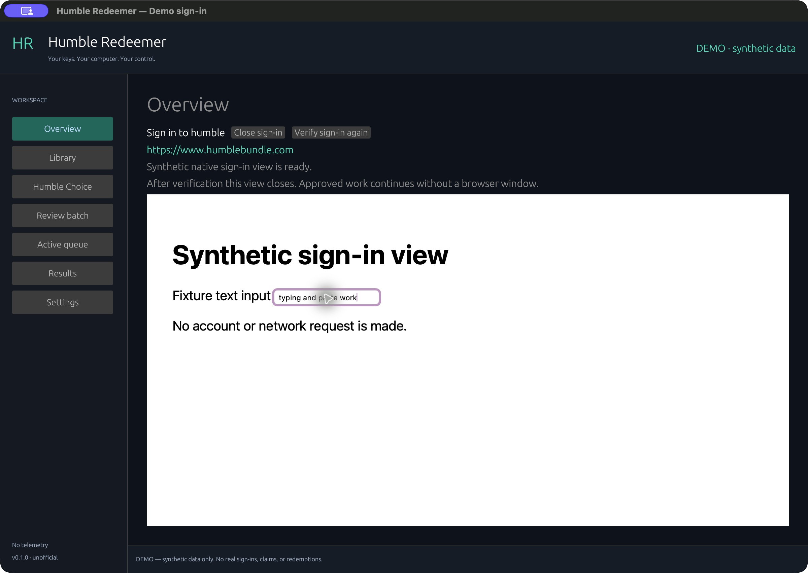

# Humble Redeemer

A native Rust desktop app for managing Humble Bundle keys and activating them on Steam. Unofficial, independently implemented, local-first, and free of telemetry.

**Prerelease software.** Browser sign-in and store endpoints can change. Review each batch before approving it. This utility does not purchase games, pay subscriptions early, activate promotional memberships, or operate a wallet.

## Features

- PlayStation free-content inbox, regional filters, user-operated official-page checklists, encrypted browser sessions, local claim history and optional deadline reminders. [PSN guide and coverage limits](docs/PSN.md).
- Native egui/eframe interface: connections, searchable library, Humble Choice, batch review, background queue, results and settings.
- Official provider sign-in inside a private native WebView; typing/paste stay in the app. Verified sessions run windowless afterward and restore on restart.
- Encrypted private session and key storage backed by the operating system's credential store; session-only fallback.
- Exact Steam app ownership checks without the retired `GetAppList` endpoint or a Steam API key.
- Separate results for owned keys, keys activated elsewhere, expired keys, exhausted stock, activation limits and uncertain outcomes.
- Persisted, account-bound batches with explicit reveal permission, pause/resume/cancel and shared activation cooldowns that new batches cannot bypass.
- Local CLI and official Rust SDK stdio MCP tools. Assistant responses never contain passwords, cookies or product keys.
- Local CSV history migration that preserves ambiguous legacy outcomes and leaves original files unchanged.



## Install

Download your platform's installer from [GitHub Releases](https://github.com/brk275/humble-redeemer/releases). Initial packages are **unsigned by a publisher**; macOS bundles have an ad-hoc signature, not Apple notarization. A signature or release download alone is not proof of live account testing. See [verification status](docs/VERIFICATION.md).

Targets: macOS Apple Silicon and Intel, Windows x64, Linux x64 (Ubuntu 22.04 baseline). Linux needs an X11/XWayland desktop session, WebKitGTK 4.1, GTK 3, OpenGL, D-Bus, libxkbcommon-x11 and a Secret Service provider for persistent secrets. Windows needs the Microsoft WebView2 Runtime (normally included with Edge). File dialogs use the desktop portal. Keep `hrctl` beside the GUI executable.

The default embedded sign-in needs no separate Chrome/Firefox window or browser driver. An explicit CLI compatibility option (`hrctl connect humble --browser chrome`) retains the verified WebDriver adapter. **Python, Node and Selenium's Python package are not runtime dependencies**.

## Use

1. Open Humble Redeemer and connect Humble and Steam in the embedded official pages. Enter credentials and finish security checks there. The app closes the view after it independently verifies the background session.
2. Synchronize the library. Select eligible games or existing Choice entitlements.
3. Review the exact titles and reveal permission. Revealing keys removes gift-link availability.
4. Approve the batch once. The worker keeps processing that scope when the window closes.
5. Review distinct outcomes in Results. Use Settings for local history imports and exports.

Claiming a Choice game on Humble does not activate it on Steam. **Humble Choice → View claimed Choice keys awaiting Steam** opens the filtered library for those existing keys. Ready keys can be reviewed for activation; Unrevealed keys also need explicit reveal permission in the batch review. Unclaimed monthly selections remain in a separate section on the Choice screen.

Steam activation limits persist across cancellation, new batches and restarts. The worker honors `Retry-After`, including HTTP dates; absent guidance, it waits one hour after an activation-limit response. It never rotates accounts, bypasses the limit or blindly replays an uncertain activation. Expired sessions require manual sign-in again.

The legacy Python tool must finish or be paused before starting a Rust redemption worker. The app detects a running legacy script and refuses concurrent activation.

## PlayStation

Open **PlayStation**, choose your Sony account’s store locale, and refresh public offers. Prepare a checklist, complete each claim yourself on the official page, and record a user-confirmed result. All free-content categories can be tracked, with manual official links for missing offers. Discovery is incomplete when public Store pages expose only a JavaScript shell; coverage gaps and Unknown fields are shown explicitly. No PSN account bot, automatic purchase, or subscription enrollment is included. See [PSN setup, browser fallback, privacy and assistant commands](docs/PSN.md).

## CLI

```sh
hrctl status --json
hrctl connect humble
hrctl connect steam
hrctl sync
hrctl library --search "Example"
hrctl library --choice-only --eligible-only --json
hrctl plan --games <game-id> --allow-reveal
hrctl batch approve <batch-id> --digest <reviewed-digest>
hrctl batch start <batch-id>
hrctl batch pause <batch-id>
hrctl batch resume <batch-id>
hrctl batch cancel <batch-id>
hrctl export redemption-report.csv
hrctl quit --pause
```

`--demo` selects an entirely separate synthetic profile and makes no account or activation requests. `humble-redeemer --demo` opens its GUI. `hrctl mcp` starts the local assistant interface; see [MCP setup](docs/MCP.md).

## Build and test

Use current stable Rust with a native compiler toolchain. On Linux install the development packages listed in the workflow. Python 3.11+ is used only by build/test scripts.

```sh
cargo build --workspace --locked
cargo test --workspace --locked
python3 scripts/smoke.py
cargo run -p humble-redeemer -- --demo
```

Native CI builds and launches the GUI on all target platforms, runs the worker/CLI/MCP integration checks, and packages installers. CI uses synthetic data and never receives account credentials or real keys.

## Privacy and provenance

Application data belongs in the OS user-data directory, outside the checkout. Do not put real keys, cookies, exports, profiles, screenshots or account logs in this repository. [Privacy design](docs/PRIVACY.md) explains storage and diagnostics.

Inspired by the workflows of [FailSpy's Humble Steam Key Redeemer](https://github.com/FailSpy/humble-steam-key-redeemer). This is an independent Rust implementation, not an upstream release or a redistribution of its unlicensed Python source. Humble Bundle and Steam are trademarks of their respective owners; this project is unaffiliated.

MIT license. Third-party licenses accompany packaged builds.
